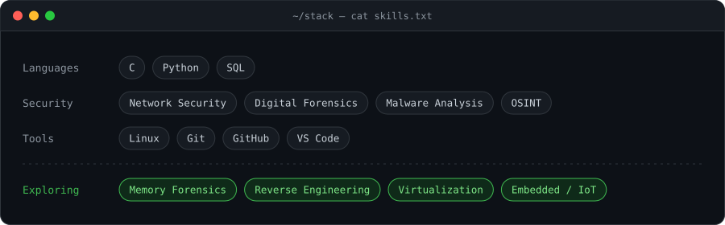
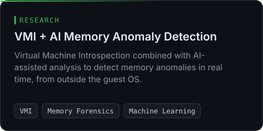
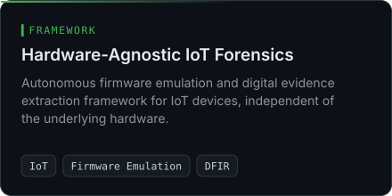

 

 

## About

I'm a cybersecurity student studying **Management Information Systems at Ankara University** and learning low-level software at **42 Istanbul**. I'm most interested in what happens *under* the operating system — memory, firmware and network traffic — and in building tools that turn that data into evidence.

-  Researching **memory forensics** with Virtual Machine Introspection and AI-assisted anomaly detection
-  Building a **hardware-agnostic IoT forensics** framework based on firmware emulation
-  Learning network security, malware analysis and digital forensics, one project at a time

## Tech Stack

## Projects

  
  

## Get in Touch

Open to research collaborations, CTF teams and internship opportunities in security.

<!-- Eklemek istersen (KULLANICI_ADI kısmını kendi bilginle değiştir):

-->
